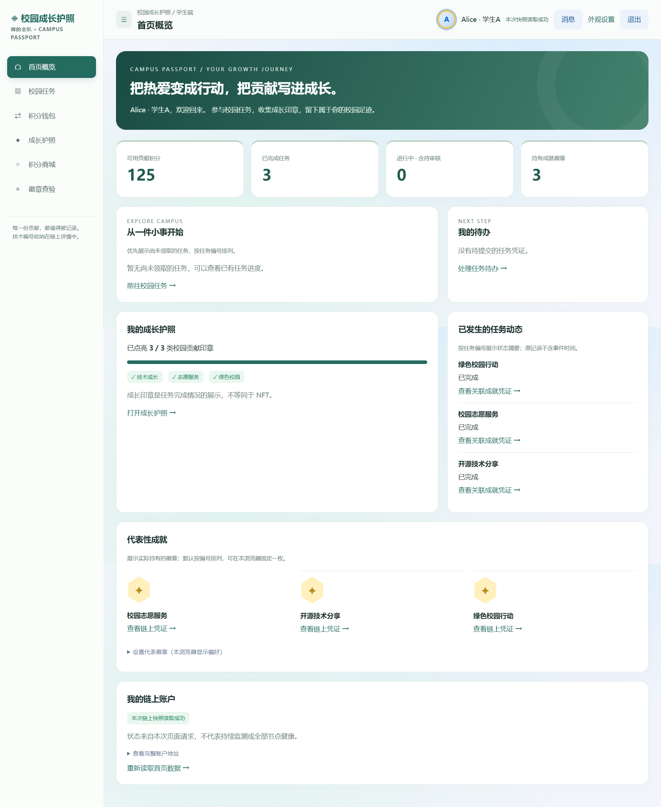
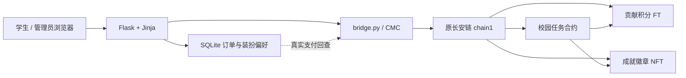

# 校园成长护照 · Campus Passport

**做的全队｜校园链上数字资产管理平台**

基于原长安链 `chain1` 的校园贡献积分、任务审核、成就徽章与数字装扮应用。学生领取任务、提交材料摘要，管理员审核后由任务合约协调 FT 奖励与 NFT 成就，形成可查验的校园贡献记录。

本仓库保存 VMware 导出的实际运行源码、38 张实验截图、配置示例及工程说明。发布的是**当前已实现版本**：V10 公共布局和双端首页已有实际截图，完整 Joi 校验、全部业务页面重构等不属于已完成能力。



## 功能与特色

| 模块 | 当前实现 |
|---|---|
| 身份 | 管理员、Alice、Bob；Web 登录与原链身份配置对应 |
| FT 积分 | 管理员发行、转账、余额与发行量查询、任务奖励授权 |
| NFT 徽章 | 管理员独立颁发、任务成就颁发、持有人与材料摘要查验；不可转让 |
| 校园任务 | 发布、领取、提交摘要、审核、退回补充、状态查询 |
| 成长护照 | 技术成长、志愿服务、绿色校园；满足原合约条件后领取一次 30 积分奖励 |
| 数字装扮 | 星环头像框 20 积分、极光个人背景 35 积分；兑换、支付回查、启用、恢复默认 |
| V10 GUI | 分角色侧栏、首页概览、消息抽屉、代表徽章偏好、技术编号折叠 |
| 业务验证 | 截图覆盖去重、越权、失败状态不变、余额守恒与交易/区块交叉查询 |

创新点在于把任务审核、贡献积分、身份绑定成就、成长奖励与积分消费串成校园业务闭环，并保留可核查的材料摘要和支付凭证。数字装扮是链上支付对应的**链下应用权益**，不是新增商城合约，也不是可转卖的 NFT。

## 架构



三个合约使用同一份 Go 源码，按初始化角色分别部署：

| 角色 | 原合约名称 |
|---|---|
| FT | `jifen_zuodequandui_campus` |
| NFT | `badge_zuodequandui_campus` |
| 任务 | `task_zuodequandui_campus` |

应用调用路径为 Flask → CMC → 长安链。`contract/go.mod` 固定合约 SDK `v2.3.4`；保留 `go.sum`。源码导出环境信息见 [来源清单](docs/source-export-manifest.json)。

## 目录

```text
campus-passport/
├── app.py                      # Web 入口、身份、CSRF 与业务交互
├── bridge.py                   # CMC 调用、回执解析、部署/绑定和查询
├── shop.py                     # 订单、支付核验、装扮权益与外观设置
├── acceptance.py               # 原实验验收脚本，含真实写入，不自动执行
├── requirements.txt            # 从原环境记录提取的 Web 运行依赖
├── requirements-lock.txt       # 原环境完整记录，含无关 ROS 包，不用于安装
├── settings.example.json       # 不含凭据的配置示例
├── templates/                  # 五个 Jinja 模板
├── contract/                   # main.go、go.mod、go.sum
├── scripts/build_contracts.sh   # 仅编译打包，不部署
├── tools/
│   ├── check_package.py        # 不连接链的工程与模拟渲染检查
│   └── create_users.py         # 交互生成密码哈希，不覆盖已有文件
└── docs/                       # 配置、技术报告、验证记录和截图索引
```

## 在原 VMware 环境运行

保留原工程的 `settings.json`、`users.json`、`config/`、证书、`shop.sqlite3` 和 `results/`。仓库是可分发源码，不是原链和订单数据库的完整备份。尤其不能删除原 `shop.sqlite3` 后期待装扮权益自动恢复。

```bash
cd "$HOME/zuodequandui-lab/campus-assets"
mkdir -p results
"$HOME/zuodequandui-lab/final-points/.venv/bin/python" app.py
```

使用原虚拟机地址的 `5001` 端口访问。已有实例运行时按原管理方式停止后再启动。重启后重新登录属于原应用会话密钥行为。

## 新的应用目录

以下步骤只准备应用依赖和本地配置，不重建链、不部署合约、不执行资产操作。需要自行接入有权限使用的原网络或独立实验网络。

```bash
python3 -m venv .venv
source .venv/bin/activate
python -m pip install -r requirements.txt
mkdir -p results config
test -e settings.json || cp settings.example.json settings.json
```

编辑 `settings.json` 中的 CMC 目录，确保合约名称与实际部署一致。按 [配置说明](docs/CONFIGURATION.md) 配置三个合法身份。原环境完整记录含 ROS 包，**不要直接安装 `requirements-lock.txt`**。

若没有原登录文件，可交互创建本应用登录密码哈希：

```bash
python tools/create_users.py
python tools/check_package.py
python app.py
```

账号标识固定为 `admin`、`alice`、`bob`。工具只生成 Web 密码哈希，不创建或改变链上身份，没有默认密码。服务启动时会查询原链身份；链或身份配置不可用时不能按离线演示模式启动。

## 合约构建与原链保护

在有 Go 工具链和 `7z` 的 Linux 环境中：

```bash
bash scripts/build_contracts.sh
```

构建目标为 Linux amd64，产物名称与 `bridge.py` 一致。脚本遇到同名产物会停止，不部署合约。发布整理环境未安装 Go，**本次没有重编译合约**；原编译和部署证据见截图 02a/02b/03。

`bridge.py deploy`、`bridge.py bind`、`acceptance.py` 和页面资产操作会影响真实链状态，不是启动或只读检查步骤。已有原链不应重新执行部署和授权。

## 页面与路由

| 入口 | 用途 |
|---|---|
| `/` | 登录／分角色首页 |
| `/#tasks` | 校园任务／任务管理 |
| `/#wallet`、`/#passport` | 学生积分钱包、成长护照 |
| `/#review`、`/#points`、`/#badges` | 管理员审核、积分和徽章管理 |
| `/shop` | 学生商城／管理员兑换记录 |
| `/verify?id=...` | 徽章查询与材料摘要比对 |

`#` 视图切换没有新增后端 API。原 `/login`、`/logout`、`/act` 和 `/shop/*` 表单仍按原字段提交；权限由原后端和合约处理。

## 截图与验证

- [38 张截图索引](docs/SCREENSHOTS.md)：原实验、商城扩展、V10 分组保存。
- [工程验证记录](docs/VALIDATION.md)：区分实际静态检查、模拟渲染与用户提供的原链截图。
- [实验技术报告](docs/EXPERIMENT_REPORT.md)：依据源码和现有截图整理，不代替组织方指定格式的正式报告。
- [提交范围与已知缺项](docs/SUBMISSION_AUDIT.md)。

商城阶段截图显示 Alice 125、Bob 60、校园兑换账户 55，合计 240 积分，徽章 3 枚。恢复默认后余额保持 125、两件商品仍已拥有。这是历史截图状态，不代表读取仓库时的实时余额。

## 限制与数据边界

- 当前为训练营实验应用，使用 Flask 开发服务器；未声明为生产级部署。
- 凭证只保存摘要；用户应自行保管原文/原文件。
- 没有事件时间就不伪造“最新动态”或学期时间轴；没有全量流水就不宣称累计收入/支出。
- 商品支付转入校园兑换账户，不减少发行总量；浏览器偏好不是资产所有权。
- V10 三个精确桌面视口的完整矩阵仍未验证；有大窗口、长截图与新版窄窗口证据。
- Joi、更多商品类别、IPFS、ZKP、跨链和完整事件订阅未在本版本实现。
- 原程序部分业务异常仍直接显示底层错误文本；生产使用前需统一脱敏和错误分类。
- 交易状态不明时应先回查，不能自动重复支付。

仓库不包含真实 SDK 配置、证书、私钥、密码哈希文件、订单数据库及业务日志。未擅自附加开源许可证，授权由作者确定。私有仓库提交评审时需另行授予访问或提交工程压缩包。
